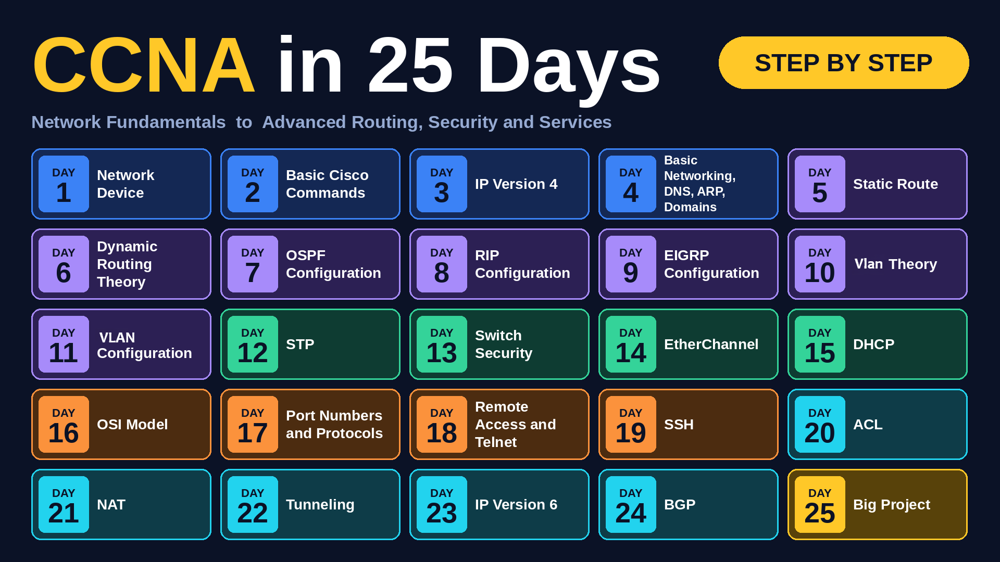

# CCNA-In-25-Days
A 25-day practical CCNA learning journey covering networking fundamentals, routing, switching, network security, and advanced networking concepts through Cisco Packet Tracer labs and hands-on configurations.

This repository documents my daily learning progress, including network topology diagrams, Cisco configuration commands, and practical implementation screenshots.

## Learning Roadmap

The following roadmap represents my complete 25-day CCNA learning journey, from basic networking concepts to advanced routing and a final networking project.

## Topics Covered

|   Day  | Topic                                |
| :----: | ------------------------------------ |
| Day 01 | Network Devices                      |
| Day 02 | Basic Cisco Commands                 |
| Day 03 | IP Version 4                         |
| Day 04 | Basic Networking, DNS, ARP & Domains |
| Day 05 | Static Routing                       |
| Day 06 | Dynamic Routing Theory               |
| Day 07 | OSPF Configuration                   |
| Day 08 | RIP Configuration                    |
| Day 09 | EIGRP Configuration                  |
| Day 10 | VLAN Theory                          |
| Day 11 | VLAN Configuration                   |
| Day 12 | Spanning Tree Protocol (STP)         |
| Day 13 | Switch Security                      |
| Day 14 | EtherChannel                         |
| Day 15 | DHCP                                 |
| Day 16 | OSI Model                            |
| Day 17 | Port Numbers and Protocols           |
| Day 18 | Remote Access and Telnet             |
| Day 19 | Secure Shell (SSH)                   |
| Day 20 | Access Control List (ACL)            |
| Day 21 | Network Address Translation (NAT)    |
| Day 22 | Network Tunneling                    |
| Day 23 | IP Version 6                         |
| Day 24 | Border Gateway Protocol (BGP)        |
| Day 25 | Final Networking Project             |

## Learning Materials

Each daily folder includes relevant practical learning materials:

* **Network Topology:** Visual representations of network designs and lab scenarios.
* **Configuration Commands:** Cisco IOS configuration commands with screenshots.
* **Practical Screenshots:** Evidence of lab implementation and configuration results.

## YouTube Video Tutorials

Alongside this documentation, I have also uploaded 25 practical YouTube videos covering the topics included in this CCNA learning journey.

Each video corresponds to the topics covered in this repository and demonstrates practical networking concepts, configurations, and lab implementations.

**YouTube Playlist:** [CCNA in 25 Days – Practical Networking Labs](https://youtube.com/playlist?list=PLRZ6sHBdGUf8&si=7RbVH_tMYOvV3pdB)

If you need additional guidance or want to see the practical implementation of any topic, feel free to explore the playlist for step-by-step video demonstrations.

## Tools & Technologies

* Cisco Packet Tracer
* Cisco IOS CLI
* IPv4 and IPv6
* Routing and Switching
* Network Security
* Network Troubleshooting

## Learning Objectives

* Understand fundamental networking concepts and network devices.
* Configure and troubleshoot Cisco routers and switches.
* Implement VLANs and Inter-VLAN Routing.
* Configure Static and Dynamic Routing Protocols.
* Understand and implement OSPF, RIP, EIGRP, and BGP.
* Implement network security using ACLs and Switch Security.
* Configure DHCP, NAT, SSH, and Network Tunneling.
* Understand IPv4 and IPv6 addressing.

## Final Project – Day 25

The final day focuses on a practical networking project that combines the networking concepts and configurations covered throughout this learning journey.

## Progress

**Completed: 25/25 Days**

This repository represents my hands-on CCNA learning experience and my continuous effort to develop practical networking skills.

---

**Learning by Doing | Building Practical Networking Skills**
